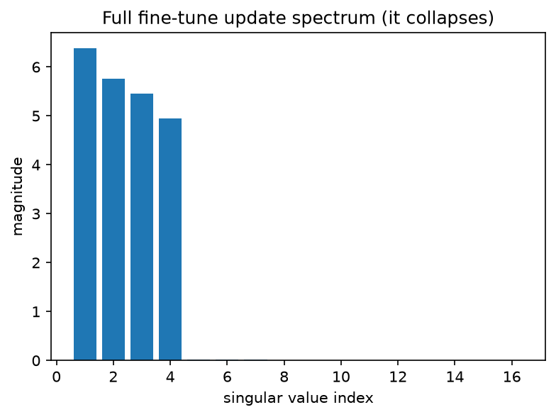
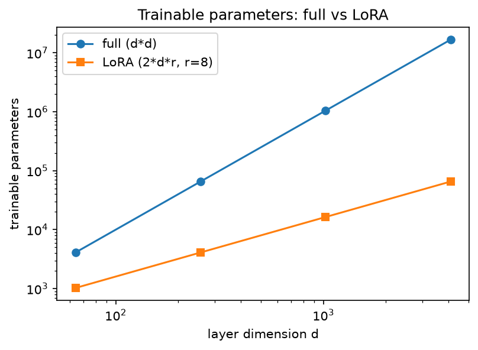
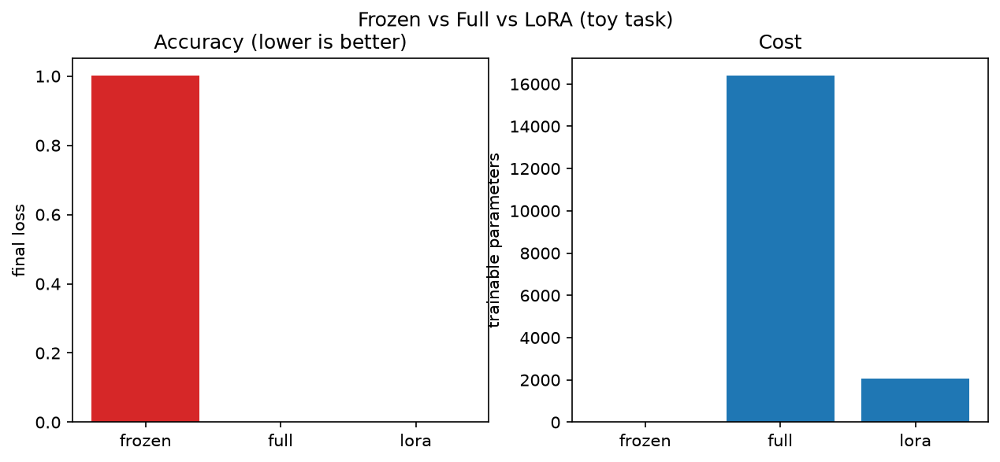
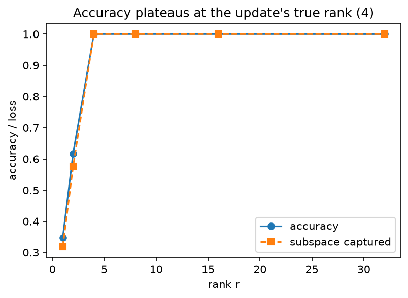
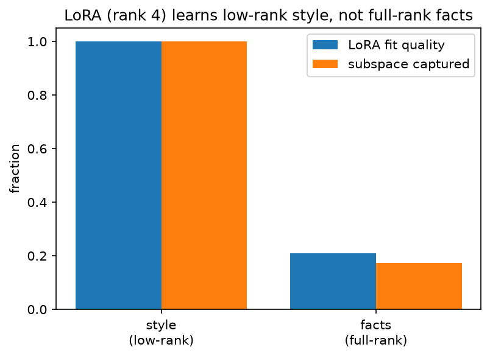
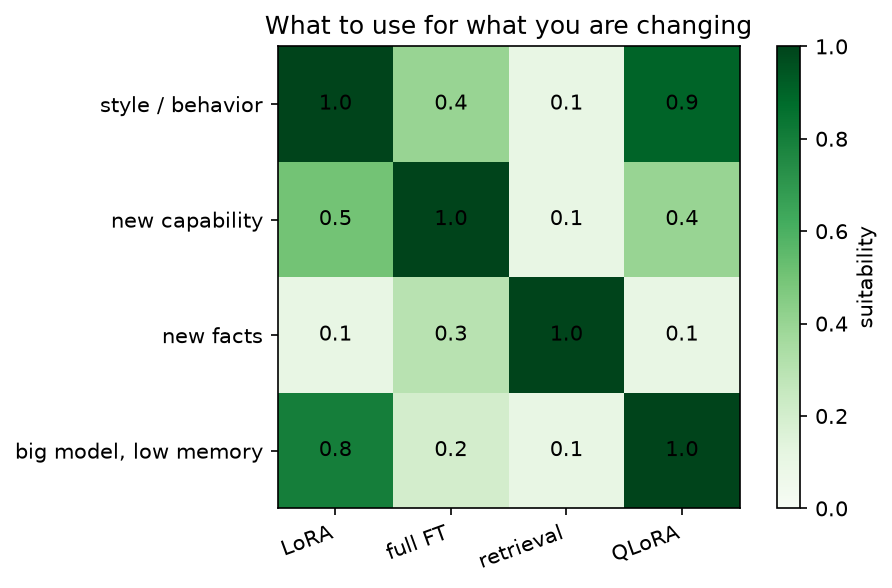

# LoRA 101: You Are Fine-Tuning Millions of Weights to Learn What Fits in a Thousand

*I planted a low-rank change into a small network, so I knew in advance how much there was to learn, and then I watched two tiny matrices recover all of it while the rest of the model sat frozen.*

You want to adapt an open model to your task, so you reach for the four lines everyone reaches for. Load the model, wrap it with `get_peft_model`, set `r=8`, and train. It works often enough that you never have to ask what those four lines did. Then someone asks you why eight and not four, or whether to adapt the attention layers or all of them, or why the model picked up the tone of your documents but still gets the facts wrong, and you notice that you have been turning a knob with a number on it and no scale behind the number.

LoRA is taught as a config. It is a lot more useful as an idea, and the idea is short enough to hold in your head. When you fine-tune a model the ordinary way, every weight moves. If you subtract the old weights from the new ones, the change you made has almost no rank. It lives in a handful of directions. LoRA skips the detour: instead of learning a whole new weight matrix and discovering afterward that the change was tiny, it learns the change directly, as the product of two thin matrices, and leaves the original model untouched.

I wanted to see that rather than take it on faith, so I built LoRA from scratch in plain PyTorch, on two CPU cores, with no GPU anywhere. To keep myself honest I used a task where I planted the answer: a small linear model with a change of known rank sewn into it, so I could say ahead of time exactly how much real information the new task added. Everything below comes out of that one repository, and every number is one the code printed.

## TL;DR

- The change full fine-tuning makes to a weight matrix is low-rank. On my planted task the update had four nonzero singular values and the rest were essentially zero.
- Adapting a 1024 by 1024 layer the full way trains about a million numbers. LoRA at rank four trains 8,192 of them, which is 0.78 percent.
- My from-scratch LoRA reached a loss of 0.0000274 against the full fine-tune's 0.0000281. The frozen model sat at about 1.0. Same accuracy, one eighth of the parameters on this tiny model and far less on a real one.
- I checked the from-scratch layer against Hugging Face `peft` on identical weights. The outputs matched with zero difference.
- Accuracy rises with rank and then stops rising the moment the rank reaches the update's true rank. Higher ranks buy nothing.
- LoRA learns a low-rank change (style, format, tone) almost perfectly and a full-rank change (arbitrary new facts) almost not at all. That is not a bug. It is the point.

## The arithmetic you should run before you train

Take a weight matrix of size d by d. Full fine-tuning treats every entry as a free parameter, so it trains d times d numbers. For a 1024 by 1024 layer that is a little over a million, and a transformer stacks many such matrices, so the real count runs into the hundreds of millions.

LoRA replaces the free matrix with two thin ones. A down-projection squeezes the d-dimensional input into r numbers, and an up-projection expands those r numbers back to d. Their product is a d by d matrix, but it can only ever have rank r, and it costs two times d times r parameters to store. At rank four that 1024 by 1024 layer drops from about a million trainable numbers to 8,192. The saved adapter is measured in kilobytes, not gigabytes, and you can keep one frozen base model with a drawer full of swappable adapters beside it.

The obvious objection is that you are approximating a big matrix with a small one and must be throwing something away. The next section is the reason you are not.

## Why a small matrix is enough



*The singular values of the change that full fine-tuning made to the weight matrix. Four of them carry the update and the rest are rounding error. I planted a rank-four change, and the fine-tune found exactly that.*

Here is the experiment. Fine-tune every weight of the small model on the new task until the loss is near zero, then subtract the original weight matrix from the trained one. Call that difference the update. Take its singular value decomposition, the same tool `dim_reduction_arena` runs on data, and look at the singular values.

They fall off a cliff. On my task the first four were about 6.4, 5.8, 5.4 and 5.0, and the fifth onward sat around 0.02. The update is not a dense d by d object that happens to be small in size. It is a rank-four object living inside a d by d container. The first direction alone accounted for about a third of the update, and the first four accounted for all of it.

This is the fact the whole method rests on. The change a task asks of a model is low-rank, so a low-rank parameterization is not a compromise. It is the correct shape. You are not shrinking the update. You are matching it.

## Building the thing

The layer is short enough to read in one sitting. Keep the original weight W and freeze it. Put two small matrices beside it, A with shape r by d and B with shape d by r. The output is the frozen part plus a scaled correction:

```python
# W is frozen; only A and B train
y = x @ W.T + (alpha / r) * (x @ A.T) @ B.T
```

Three details make it behave. The scaling is alpha over r, so changing the rank does not quietly change the size of the correction underneath you. The matrix A starts from a small random init and B starts at exactly zero, which means the correction is zero on the first step and the model is bit-for-bit the one you began with; it only drifts away as training asks it to. And only A and B carry gradients. The base never moves.



*Trainable parameters as the layer grows. The full count climbs with the square of the dimension while the LoRA count climbs in a straight line at fixed rank, so the gap widens the bigger your model gets.*

I verified those three claims in code instead of asserting them in prose. The forward pass equals the base model's forward pass at step zero. Gradients reach A and B and nothing else. The trainable count is exactly two times d times r. Those are tests in the repository, not promises in an article, and they run in a few seconds.

## The race

Now put three models side by side on the same task. A frozen model that is not allowed to change, as the floor. A full fine-tune that may change every weight, as the ceiling. And LoRA, with its two thin matrices, in between.



*Final loss on the left: the frozen model is stuck near 1.0 while the full fine-tune and LoRA both reach essentially zero. The cost of getting there, in trainable parameters, on the right.*

The frozen model sat at a loss of about 1.0, because it was never allowed to learn the change. The full fine-tune drove the loss to 0.0000281 by moving all 16,384 of its weights. LoRA reached 0.0000274, a shade better on this run, by moving 2,048. Same destination, one eighth of the parameters, and this is a deliberately small model. On a real one the adapter is a rounding error on the parameter budget and the gap between the two losses stays this small.

A from-scratch implementation is only as trustworthy as its agreement with a known-good one, so I built the same adapter in `peft`, copied the identical weights into both layers, and compared the outputs. The largest difference between them was zero. The from-scratch version is doing exactly what the library does, which is the whole reason to read mine: it tells you what the library is doing.

## The one knob, with a scale behind it

Rank is the only real dial on a LoRA adapter, and most people set it to eight because a tutorial set it to eight. You can do better by sweeping it.



*Fit quality and captured subspace against rank. Both climb together and both flatten at rank four, the true rank of the planted update. Everything to the right of the knee is capacity you paid for and did not use.*

I swept the rank upward from one and plotted how well LoRA fit the task. At rank one it recovered about a third of the change. At rank two, a bit over half. At rank four it was finished, and ranks eight, sixteen and thirty-two added nothing at all. The curve has a knee, and the knee sits exactly at the rank of the update I planted. Lay the fraction of the update's subspace that each rank can capture on top of the accuracy line and the two track each other almost perfectly, which tells you the plateau is not a quirk of training. It is the point where the adapter is finally big enough to hold everything the task asked for.

The practical reading is simple. Pick the rank by finding where your validation curve stops improving, not by copying a number. Too small and the adapter cannot hold the task. Too large and you are paying for rank you never touch.

## Where it breaks, and why that is the useful part

LoRA is excellent at some changes and close to useless at others, and the difference is the same low-rank story told backward.



*The same small adapter against two kinds of change. A low-rank change, the sort a style or format adaptation makes, is captured and fit almost perfectly. A full-rank change, the sort that arbitrary new facts require, is mostly missed.*

I set up two targets. One was a low-rank change, the kind of adjustment you make when you teach a model a tone, a format, a house style, or a sentiment label. The other was a full-rank change, the kind you would need to pour in a body of unrelated facts, where every association points in its own independent direction. I handed the same small adapter to both.

The low-rank target was fit almost perfectly, with the adapter capturing essentially all of it. The full-rank target was mostly missed: the adapter captured about a sixth of it and the fit quality came out at 0.21. This is the mechanism behind a complaint you may have made yourself, that a fine-tuned model learned the phrasing of your facts but still answers them wrong. Style is a low-rank change, so LoRA learns it cleanly. A pile of facts is high-rank, so a small adapter cannot hold it, and no choice of rank fixes that without handing back the savings that made LoRA worth using in the first place. When the thing you want to change is facts, the tool is retrieval, not a bigger adapter.

## So what do you actually do



*What to use for what you are changing. Darker is a better fit.*

Reach for LoRA when you are changing behavior: tone, format, domain phrasing, a classification head, the shape of the output. That covers most of what people call fine-tuning, and it is exactly where the low-rank assumption holds. Read the rank off the plateau. Adapt the attention and feed-forward projections rather than every layer, because that is where the useful change lives. When you ship, you can fold the adapter back into the weights and serve a single model with no extra inference cost, or keep it separate and swap adapters to serve many tasks from one base.

Reach for something else when the assumption breaks. New facts belong in retrieval. A genuinely new capability, the kind that needs the whole model to move, is one of the few honest cases left for a full fine-tune. And when the real problem is that the base model will not fit in memory, you quantize the frozen base and adapt it with LoRA, which is what QLoRA is.

All of it hangs on one line I would keep if I had to throw out the rest. A new task adds far less information to a model than its parameter count suggests. Full fine-tuning does not know that, so it moves millions of weights and lands on a change that a few hundred numbers could have described. LoRA knows it, and spends only what the task is worth. You were fine-tuning millions of weights to learn what fits in a thousand.

The from-scratch layer, the tests, and the notebooks that produced every figure here are in the repository, built to run on two CPU cores with no GPU: [lora_101](https://github.com/Dima806/lora_101).
